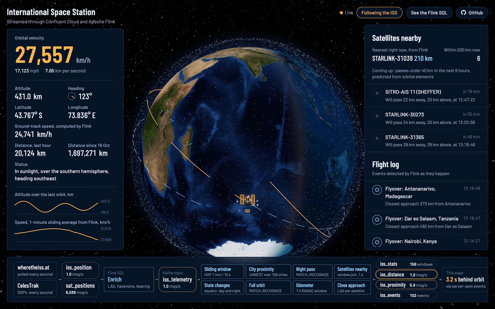

# The ISS, live, through Kafka and Flink



The International Space Station circles the Earth every 93 minutes at about 27,600 km/h.
This project follows it in real time: once a second, a position fix goes into Kafka on
Confluent Cloud. Flink SQL turns that thin feed into speed, heading, day and night, city
flyovers and measured orbit periods, and a 3D globe shows all of it as it happens.

Everything is defined in code and runs in the cloud. One `terraform apply` creates the Kafka
cluster, Schema Registry, the Flink pipelines and the AWS host that serves the dashboard.

## Why it's a good streaming demo

**One message says almost nothing.** Each fix from the ISS API is a latitude, a longitude,
an altitude and a timestamp. Everything interesting comes from relating messages to each
other over time, and that's exactly what stream processing is for:

| The question | What Flink does | Statement |
|---|---|---|
| Which way is it going, and how fast over the ground? | Compares each fix with the previous one (`LAG`) using haversine distance and great-circle bearing | `iss-enrich-telemetry` |
| Is it crossing the equator? Did the sun just rise? | Detects when a value flips between two consecutive fixes | `iss-orbital-events` |
| Is it passing over a city right now? | Fans every fix out across 35 cities with `UNNEST` and finds the moment of closest approach | `iss-city-flyovers` |
| How has it been doing over the last minute? | Sliding `HOP` window: 1 minute wide, updated every 10 seconds | `iss-stats-hop-window` |
| How far has it gone? | A 1-hour `RANGE` window plus a running total | `iss-distance-odometer` |
| How long is one orbit? How long is a night in orbit? | Pattern matching across thousands of rows with `MATCH_RECOGNIZE` | `iss-orbit-complete-cep`, `iss-eclipse-pass-cep` |

**The results are real and you can check them.** Flink measures the orbital period from
the data itself; it should come out near the published 92.9 minutes. It measures how long
the station spends in Earth's shadow on each orbit (one pass in the screenshot took 33.4
minutes). The altitude chart traces the orbit's slight eccentricity, rising and falling by
about 12 km every revolution. The "ground-track speed" of roughly 24,900 km/h is lower than
the 27,600 km/h orbital velocity. Flink measures it between points on the rotating Earth's
surface, while the orbit runs 420 km higher.

**It's all declarative.** The pipelines are 12 SQL files. There are no jobs to compile or
clusters to run, and Terraform deploys each SQL file as a Flink statement.

## What's on the screen

- **The globe** shows a real day/night terminator, computed from the subsolar point in the
  feed with city lights on the night side. The ISS marker sits inside a ring that marks its
  visibility footprint.
- **The trail** covers the last orbit. It's amber where the station was in sunlight and grey
  where it was in Earth's shadow, using the `sunlit` column computed by Flink.
- **The dashed line** is the next orbit, predicted in the browser from the station's current
  orbital elements (TLE) with satellite.js.
- **Telemetry** on the left comes entirely from Flink output topics: velocity, altitude,
  heading, ground-track speed and distance travelled.
- **The flight log** lists Flink's events as they're detected. Click one to fly the globe
  there; city flyovers also pulse on the map.
- **The pipeline strip** shows live message rates per topic and how many seconds the page
  runs behind the ISS (usually about 3).

URL options:

- `?view=32,35` opens on a fixed latitude and longitude instead of following the station.
- `?presenter=1` adds an "Open Flink statements" button that links to the running statements
  in your Confluent Cloud console. It's hidden by default because it only works for members
  of your Confluent organization.

The header links to this repository and its Flink SQL. Point `repo_url` in
`terraform.tfvars` at your fork, or set it to `""` to hide the links.

## Architecture


- **Producer** (Python, on EC2) polls [wheretheiss.at](https://wheretheiss.at/w/developer)
  every second and writes Avro to `iss_position`, timestamped with the ISS fix time.
- **Flink SQL** owns the data model. `CREATE TABLE` statements create every topic and
  register its Avro schema; the producer fetches the schema from Schema Registry instead
  of defining its own.
- **Dashboard server** (FastAPI, on the same EC2 instance) consumes the five topics,
  replays the last orbit on startup, and pushes updates to browsers with server-sent events.
- **CloudFront** provides the public HTTPS URL. The instance accepts traffic only from
  CloudFront, credentials live in Secrets Manager, and shell access is through SSM rather
  than SSH.

### Details worth knowing

- **Event time.** Every table uses the ISS fix time as event time, with a 2-second
  watermark, so windows and pattern matches follow the station's clock, not processing time.
- **A stateless flyover detector.** Partitioning by city after an `UNNEST` loses the
  event-time attribute in Flink. So the enrich step carries the previous two fixes on
  every row, and the flyover query compares three distances per city on a single row.
  No per-city state is needed.
- **Exactly-once vs. live.** Flink commits its Kafka transactions at each checkpoint,
  about once a minute. The dashboard reads with `isolation.level=read_uncommitted`, so
  results appear within about 3 seconds. Downstream Flink statements read committed data,
  so stats and events arrive in roughly one-minute batches.
- **One partition per topic.** At one message a second, ordering is trivial and idle
  partitions can't hold back watermarks.
- **Replays.** A replaced Flink statement starts again from the earliest offset and can
  re-emit events. The dashboard removes duplicates by event type, title and time.

## Deploy it yourself

You need:

- Terraform 1.5 or newer, `jq` and the AWS CLI
- A Confluent Cloud account and a **Cloud resource management** API key
- An AWS account with a default VPC in the target region

```bash
cp .env.example .env                                     # add your Confluent Cloud API key
cp terraform/terraform.tfvars.example terraform/terraform.tfvars   # AWS profile, tags, regions
make infra                                               # about 10 minutes; prints the URL
```

`make infra` creates a new Confluent Cloud environment (`iss-demo`) with a Basic Kafka
cluster, Stream Governance Essentials and a Flink compute pool. It deploys all 12 Flink
statements, and on AWS it creates the EC2 host, an Elastic IP, CloudFront, an S3 bucket
for the app bundle and a Secrets Manager secret. Both default to `us-east-1`.

After deployment, expect:

| What | When |
|---|---|
| Live position, telemetry, stats | within seconds |
| City flyovers | depends on the ground track; usually within one orbit |
| Equator crossings, orbital sunrise and sunset | within about 25 minutes |
| Night pass duration | within about 1.5 hours |
| Measured orbital period | within about 3 hours; needs two equator crossings with no gap in the data |

### Running it

```bash
make url        # print the dashboard URL
make status     # phase of every Flink statement
make destroy    # remove everything, Confluent and AWS
```

Logs live on the host:

```bash
aws ssm start-session --target $(terraform -chdir=terraform output -raw app_instance_id)
sudo journalctl -u iss-producer -u iss-dashboard -f
```

Changing anything under `app/` rebuilds the bundle and replaces the instance on the next
`make infra`, which leaves a gap of a few minutes in the data.

## Cost

You pay for a Basic Kafka cluster, Stream Governance Essentials and the Flink CFUs the
statements use (the pool is capped at 20 CFUs). On AWS, the t4g.small instance, Elastic IP,
CloudFront and Secrets Manager come to roughly $15–20 a month. Run `make destroy` when
you're done.

## Repository layout

```
terraform/
  main.tf             Confluent environment, Kafka, Schema Registry, service account, API keys
  flink.tf            compute pool and the Flink statements
  sql/                one file per Flink statement
  aws.tf              EC2, CloudFront, S3, Secrets Manager
  user_data.sh.tftpl  installs and starts the producer and dashboard on the instance
app/
  producer.py         ISS API to Kafka
  server.py           Kafka to browser (server-sent events), TLE proxy
  static/             the dashboard; plain HTML, CSS and JavaScript, no build step
scripts/
  flink-status.sh     statement status through the Flink REST API
docs/                 screenshot and architecture diagram
```

## Credits

- ISS position and TLE data: [Where the ISS at?](https://wheretheiss.at/)
- Globe rendering: [globe.gl](https://github.com/vasturiano/globe.gl) and [three.js](https://threejs.org/)
- Orbit prediction: [satellite.js](https://github.com/shashwatak/satellite-js)
- Earth and night-sky textures: from the [three-globe](https://github.com/vasturiano/three-globe) examples, based on NASA imagery
